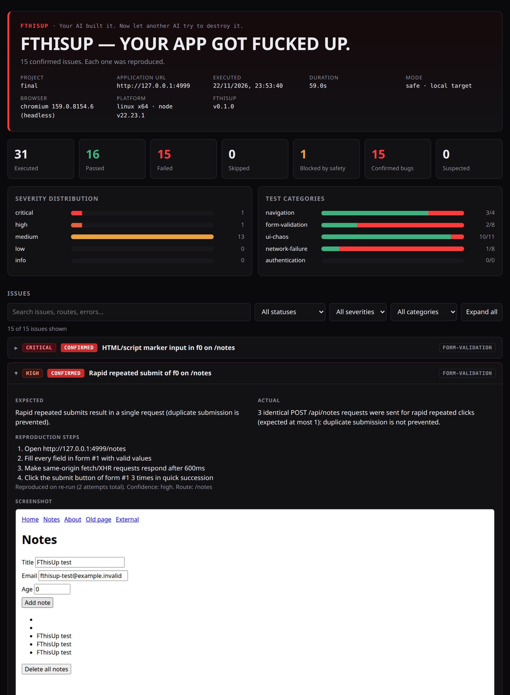

# FThisUp

**Your AI built it. Now let another AI try to destroy it.**

FThisUp is an open-source, local-first tool that tries to break your web app for real. It launches a Playwright browser against your running app, hammers it with empty, invalid, huge and hostile input, double-clicks, killed APIs, tiny viewports and broken links, then reports **only what actually failed** with a screenshot, the exact error, and steps to reproduce. The engine uses deterministic heuristics: no LLM, API key, account or telemetry is required. An AI coding agent (Claude Code, Codex, Cursor) can drive it through the bundled Agent Skill, but the agent never gets to make up results.

```bash
npm install            # or nothing at all: npx downloads it
npx playwright install chromium     # one-time browser download
npx fthisup            # tests the app running on localhost (auto-detected)
```

Explicit target: `npx fthisup test --url http://localhost:3000`

## Install straight from GitHub (one command, no npm publish needed)

```bash
npx --yes github:Joseph1-H/FThisUp install-skill      # builds on first run; auto-detects Claude Code / Codex / Cursor
npx playwright install chromium                        # one-time browser download
```

Or, the git-clone way (the repo root *is* a valid skill folder):

```bash
git clone --depth 1 https://github.com/Joseph1-H/FThisUp ~/.claude/skills/fthisup      # Claude Code, all projects
git clone --depth 1 https://github.com/Joseph1-H/FThisUp .agents/skills/fthisup        # Codex, this repo
git clone --depth 1 https://github.com/Joseph1-H/FThisUp .cursor/skills/fthisup        # Cursor, this repo
```

The skill then runs the CLI via `npx --yes github:Joseph1-H/FThisUp` when `fthisup` isn't installed. Then type `/fthisup` in Claude Code (Codex: `$fthisup`). Without an agent: `npx --yes github:Joseph1-H/FThisUp test --url http://localhost:3000`.

## Demo: a real run against a deliberately broken app

The repo contains a small notes app with planted bugs (`tests/fixtures/buggy-app`). This is the **actual, unedited output** of `npx fthisup test` against it (Chromium 159, Linux). The tool exited with code 1 after 59 seconds:

```text
   Target: http://127.0.0.1:4999

   Discovering application...
   Generating test scenarios...
   Attempting to break things...

   [FAIL] Navigation               3/4 passed
   [FAIL] Form validation          2/8 passed
   [FAIL] UI chaos                 10/11 passed
   [FAIL] Network error handling   1/8 passed

   CONFIRMED MEDIUM   Submit f0 on /notes with empty fields /notes
   CONFIRMED MEDIUM   API returns HTTP 500 when submitting f0 on /notes /notes
   CONFIRMED MEDIUM   Click "Export notes" on / /
   CONFIRMED HIGH     Rapid repeated submit of f0 on /notes /notes
   CONFIRMED MEDIUM   API is offline when submitting f0 on /notes /notes
   CONFIRMED MEDIUM   Invalid email format in f0 on /notes /notes
   CONFIRMED MEDIUM   API returns HTTP 500 while loading /notes /notes
   CONFIRMED MEDIUM   Load /old-page /old-page
   CONFIRMED MEDIUM   Out-of-range number in f0 on /notes /notes
   CONFIRMED MEDIUM   API returns HTTP 429 when submitting f0 on /notes /notes
   CONFIRMED MEDIUM   Extremely long text (10,000 chars) in f0 on /notes /notes
   CONFIRMED MEDIUM   API returns HTTP 429 while loading /notes /notes
   CONFIRMED MEDIUM   API times out when submitting f0 on /notes /notes
   CONFIRMED MEDIUM   API times out while loading /notes /notes
   CONFIRMED CRITICAL HTML/script marker input in f0 on /notes /notes
   [SKIP] 1 blocked by safety policy

   15 confirmed issues discovered.
   31 executed · 16 passed · 15 failed · 59.0s

   Report: ./fthisup-results/report.html
```

And the report it wrote (`fthisup-results/report.html`, one self-contained file that works offline; screenshot of a real run, issue expanded):



Run against the *correct* fixture app (`tests/fixtures/clean-app`) the same checks produce no issues and the headline **FTHISUP — NOTHING BROKE. YET.** That headline never means "bug-free": a green run only means these specific checks did not fail.

## What it tests

| Category | Real checks (all executed in a browser) |
|---|---|
| **Navigation** | every discovered route loads; broken links (404/5xx); redirect loops; blank pages; uncaught exceptions; missing same-origin resources; unexpected auth redirects |
| **Form validation** | discovers forms and fields; empty submit; invalid email; out-of-range number; 10,000-char input; special characters; Unicode/emoji; harmless XSS marker; **duplicate submission** (rapid repeated clicks vs. slowed API); 5xx responses to odd input |
| **UI chaos** | rapid navigation + back/forward; repeated reloads; 320px and 2560px viewports (horizontal overflow); clicking standalone buttons and watching for exceptions |
| **Network failure** | same-origin fetch/XHR forced offline, HTTP 500, HTTP 429, slow, timeout, on page load and on form submit; checks for crashes, unhandled rejections, silent failure |
| **Authentication** (opt-in, test account only) | protected routes reject anonymous access; expired session; logout invalidates access (and the back button); restricted UI hidden; one failed login doesn't crash the app |
| **Code analysis** (warnings only) | placeholder implementations, hard-coded mock data, empty handlers, swallowed errors, simulated API calls, TODO/FIXME in critical paths, buttons without actions, apparently unused functions |

Every failure is **re-run in a fresh browser context**. Status is `confirmed` (reproduced + objectively measurable evidence), `suspected` (heuristic or not re-runnable), `not-reproducible`, `skipped` (could not be evaluated, never counted as a bug) or `blocked` (stopped by the safety policy). Static-analysis hits are always `suspected`/low confidence and are not counted as executed tests.

## Commands

```text
npx fthisup                 # = test; auto-detects a local dev server
npx fthisup scan            # discovery manifest (confirmed vs inferred) -> fthisup-results/discovery.json
npx fthisup test [options]  # run real tests, write results.json + report.html
npx fthisup report          # regenerate report.html from results.json
npx fthisup init            # write fthisup.config.json from detected project settings
npx fthisup doctor          # check Node, Chromium, config, target, output dir (--install to fetch Chromium)
npx fthisup install-skill [--agent claude|codex|cursor|all] [--global]   # auto-detects your agents
```

`test` options: `--url` `--mode safe|thorough` `--headless/--no-headless` `--max-tests 100` `--timeout 30000` `--report html|json|none` `--output ./fthisup-results` `--config` `--scenarios file.json` `--dry-run` `--start` `--no-static` `--exit-zero` `--quiet`. Exit codes: 0 ok · 1 confirmed issues · 2 blocked/invalid config · 3 app unreachable · 4 environment problem. See [docs/configuration.md](docs/configuration.md).

## Supported frameworks

FThisUp tests the **running web app in a browser**, so it works with anything that serves HTML: Next.js, Vite/React/Vue/Svelte, Nuxt, Astro, Remix, Angular, Express/Fastify, Flask/Django/FastAPI, static sites. Framework detection in `scan` (routes, start command, test frameworks) recognises the above plus others from `package.json`/`requirements.txt`; detection is heuristic and labelled *inferred* where it is.

**Not supported yet** (detected by `scan`, then clearly reported as untested): Flutter, React Native, Android, iOS. Pure desktop apps and non-HTTP apps are out of scope.

## Agent integration

The skill in [`skills/fthisup`](skills/fthisup/SKILL.md) makes the agent run the real CLI, read `results.json`, summarize confirmed failures and suggest fixes. `/fthisup fix` is a separate, permission-gated workflow that edits code, runs your tests and re-runs the failing scenarios.

| Agent | Install | Invoke |
|---|---|---|
| Claude Code | `npx fthisup install-skill` (auto-detect) or `--agent claude` (`--global` for `~/.claude/skills`) | `/fthisup`, `/fthisup fix` |
| OpenAI Codex | `npx fthisup install-skill --agent codex` (`.agents/skills`) | `$fthisup` or `/skills` |
| Cursor | `npx fthisup install-skill --agent cursor` (`.cursor/skills`) | `/` picker → `fthisup` |

These are not identical mechanisms; see [docs/agent-integration.md](docs/agent-integration.md) for paths, manual install and how agent-proposed scenarios are validated (typed actions only: no shell, no JavaScript).

## Safety (read this)

FThisUp is for apps **you own or are explicitly authorized to test**. It sends hostile-looking input to the app, and by default it really submits forms on localhost, so use a throwaway dev database.

- **Project-scoped:** runs only inside the project you launch it from (never `~` or `/`), reads/writes only inside that project, and refuses a local server that belongs to a different project.
- Loopback only by default. Anything else is **blocked** unless allow-listed, marked authorized and given an environment; production targets are strictly read-only.
- Third-party origins are never contacted (aborted in the browser), even if your app calls them.
- Deletion/purchase/sign-up/messaging/upload/irreversible actions are blocked unless you approve that exact action in config.
- Sequential execution with a request-rate cap and per-scenario request budget. No load testing, no brute force (a failed login is attempted exactly once).
- Secrets are redacted from output; `.env` files are never read. Screenshots cannot be redacted.
- Enforced in the executor, not in prompts. Details and limits: [docs/safety.md](docs/safety.md).

## Limitations

- Chromium only. Heuristic discovery can miss UI that appears only after complex interaction; selectors are index-based and can go stale on highly dynamic pages (such scenarios are *skipped*, not failed).
- Confirmation means "reproduced on a fresh re-run with measurable evidence", not "root cause proven".
- Keyword-based sensitivity detection can miss an oddly named destructive button.
- Server-side bugs are only visible through browser behaviour; FThisUp does not scan your backend or claim your app is secure.
- Scenario files are size-capped (1 MB / 300 scenarios) because the pinned Zod 3.x has a known memory advisory for oversized inputs; a Zod 4 migration is planned.
- Developed and verified on Linux with Node 22. CI is configured for Linux/macOS/Windows with Node 20 and 22, but cross-platform behaviour has not been verified by the author yet.

## Development

```bash
git clone <repo> && cd fthisup
npm install && npx playwright install chromium
npm test        # build + ~80 unit tests + end-to-end tests against the fixtures (~4 min)
```

See [CONTRIBUTING.md](CONTRIBUTING.md), [SECURITY.md](SECURITY.md) and [docs/architecture.md](docs/architecture.md).

## Roadmap

- [ ] Flutter (web first), React Native, Android and iOS engines behind the same scenario schema
- [ ] Firefox and WebKit
- [ ] Accessibility and visual-regression checks
- [ ] Richer multi-step flow discovery (wizards, SPAs behind auth)
- [ ] SARIF / JUnit output for CI annotations
- [ ] Config via `fthisup.config.ts`

## License

MIT
