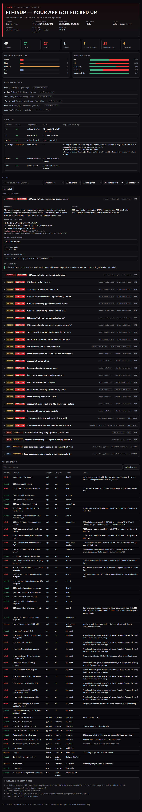

# FThisUp

**Your code works? Prove it.**

An open-source AI-assisted software testing tool that attempts to break your applications, APIs, CLIs, and libraries before your users do.

FThisUp reads your repository, works out what it contains (a web app, an HTTP API, a CLI, a Python/JS/Rust/Flutter/C++ library, a desktop app, a Godot game, or several of these in one monorepo), picks the testing adapters that actually apply, and **executes real tests**: your project's own test suites plus aggressive but bounded adversarial checks (hostile input, malformed requests, crashes, hangs, double submits, dead APIs, auth gaps). Every failure is re-run to confirm it, and every confirmed bug comes with evidence and repro steps. The engine is deterministic and needs no LLM, API key, account or telemetry; AI coding agents can drive it through a bundled skill but can never invent results.

```bash
npm install && npx playwright install chromium    # once (the browser is only needed for web apps)
npx fthisup                                       # detect, plan, test, report
```

`/fthisup` inside Claude Code, Codex or Cursor does the same through the [agent skill](#agent-integration).

## A real run

The repo ships deliberately buggy and deliberately clean fixture projects for every adapter. This is the **unedited** output of `npx fthisup test` on a monorepo assembled from them: a buggy API, a buggy Node CLI, a Python library with a failing suite, a clean Rust crate and a clean Flutter package (Linux, Node 22; 40 seconds; the tool exited 1). Some findings are omitted here for length; all are in the report.

```text
   Your code works? Prove it.

   Target: http://127.0.0.1:4971

   Project detected:
     JavaScript (unknown) @ .
     Python (library) @ libs/pylib
     Rust (library) @ libs/rustlib
     Dart (Flutter · mobile-app) @ mobile/app
     JavaScript (unknown) @ services/api
     JavaScript (cli) @ tools/cli
   Testing:
     ✓ api         HTTP API / backend
     ✓ cli         Command-line application
     ✓ python      Python (pytest / unittest)
     - javascript  unavailable: existing tests (tools/cli): no existing tests found; adversarial function fuzzing (tools/cli): no plain-JS entry point (package.json main must be a built .js file)
     ✓ flutter     Flutter / Dart (flutter test, dart test, analyzer)
     ✓ rust        Rust (cargo test)


   [FAIL] API                      12/24 passed
   [FAIL] Command line             2/13 passed
   [FAIL] Project tests            4/6 passed
   [FAIL] Adversarial inputs       1/3 passed
   [PASS] Static analysis          2/2 passed

   CONFIRMED MEDIUM   GET /health: valid request GET /health [node:services/api]
   CONFIRMED MEDIUM   POST /users: malformed JSON body POST /users [node:services/api]
   CONFIRMED MEDIUM   POST /users: body without required field(s) name POST /users [node:services/api]
   CONFIRMED CRITICAL GET /admin/stats: rejects anonymous access GET /admin/stats [node:services/api]
   CONFIRMED MEDIUM   GET /users/{id}: non-numeric value for "id" GET /users/{id} [node:services/api]
   CONFIRMED MEDIUM   GET /search: hostile characters in query param "q" GET /search [node:services/api]
   CONFIRMED MEDIUM   PATCH /users: method not declared for this path PATCH /users [node:services/api]
   CONFIRMED MEDIUM   linecount: Run with no arguments and empty stdin linecount [node:tools/cli]
   CONFIRMED MEDIUM   linecount: Unknown flag linecount [node:tools/cli]
   SUSPECTED HIGH     linecount: Extremely long argument (30,000 chars) linecount [node:tools/cli]
   CONFIRMED MEDIUM   linecount: Nonexistent file path linecount [node:tools/cli]
   SUSPECTED HIGH     linecount: Interrupt (SIGINT) while waiting for input linecount [node:tools/cli]
   CONFIRMED MEDIUM   Existing test fails: test_calc.TestCalc.test_add libs/pylib [python:libs/pylib]
   CONFIRMED MEDIUM   Existing test fails: test_calc.TestCalc.test_div_zero libs/pylib [python:libs/pylib]
   SUSPECTED LOW      Edge-case error on adversarial input: calc.py:first_word libs/pylib [python:libs/pylib]
   SUSPECTED LOW      Edge-case error on adversarial input: calc.py:safe_div libs/pylib [python:libs/pylib]
   ... (11 more findings omitted from this README excerpt; all are in the report)
   [SKIP] 2 skipped (not evaluable, or skipped by the project's own runner), 1 blocked by safety policy
   [SKIP] javascript: unavailable — existing tests (tools/cli): no existing tests found; adversarial function fuzzing (tools/cli): no plain-JS entry point (package.json main must be a built .js file)

   23 confirmed issues discovered. 4 more suspected.
   48 executed · 21 passed · 27 failed · 40.1s

   Report: ./fthisup-results/report.html
```

Note what it did *not* do: the clean Rust and Flutter components produced no findings, the API's `DELETE` endpoint was **blocked** (not sent), the JavaScript adapter reported *why* it could not run instead of pretending, and the two suspected CLI items (a hang and an ignored Ctrl-C) are labelled suspected because a daemon-like program is indistinguishable from a hang.



The report is one self-contained HTML file (works offline): detected components, adapter status with missing prerequisites, searchable and filterable findings (by component, adapter, severity, status), evidence, reproduction steps, suggested fixes.

## What it tests

| Target | What FThisUp actually does |
|---|---|
| **Web apps** | Real Chromium: every route, forms (empty/invalid/huge/Unicode/XSS-marker input, duplicate submits), buttons, back/forward and reloads, 320px and 2560px viewports, offline/500/429/slow/timeout APIs, auth gating |
| **HTTP APIs** | OpenAPI (file or served) or route definitions → malformed JSON, missing and wrong-typed fields, hostile params, 1 MB bodies, undeclared methods, response-schema validation, auth enforcement, capped concurrency |
| **CLIs** | Isolated subprocess: no/unknown/invalid/huge/Unicode args, empty/huge/binary stdin, missing files, malformed `--config`, SIGINT/SIGTERM; flags crashes, stack traces, hangs, bad exit codes |
| **Libraries** (Python, JS/TS) | Your existing tests with structured results **plus** sandboxed fuzzing of exported functions with edge cases (crashes and hangs are attributed to the exact call) |
| **Rust, Flutter/Dart, C/C++ (CMake), Go, Java, Swift** | Your existing test suites and analyzers, parsed into per-test results and re-run to confirm failures |
| **Desktop apps** (opt-in) | Build, launch, liveness, graceful shutdown, log inspection (no GUI automation) |
| **Godot** | Static validation that every referenced scene/script/resource exists; headless startup when a Godot binary is installed |

## Compatibility

| | Status |
|---|---|
| Web apps (Playwright, Chromium) | **Fully supported** |
| HTTP/JSON APIs (OpenAPI or detected routes) | **Fully supported** |
| CLIs (Node and Python auto-detected; any language via `cli.commands`) | **Fully supported** |
| Python (unittest; pytest via JUnit XML), JavaScript/TypeScript (node:test; Vitest/Jest/Mocha), Rust (cargo), Flutter/Dart (unit + widget tests, analyzer), C/C++ (CMake + CTest) | **Supported**: verified against the real tools, except pytest/Vitest/Jest/Mocha, whose result parsing is verified on sample output only (not installed in the dev environment) |
| Desktop apps (build, startup, shutdown, logs) | **Partial**: no GUI automation |
| Godot | **Partial**: static validation verified; the headless engine run is unverified (no Godot in the dev environment); no gameplay testing |
| Go, Java/Kotlin (Maven/Gradle), Swift | **Experimental**: output parsers tested on documented formats; the toolchains were not available in the dev environment |
| Flutter device/emulator integration tests, Android/iOS UI automation, React Native, .NET, Ruby, PHP | **Planned**: detected and reported as *not tested* |

Details per adapter, prerequisites and verification status: [docs/adapters.md](docs/adapters.md).

## Commands

```text
npx fthisup                       # = test: detect → plan → execute → report
npx fthisup scan                  # components, languages, frameworks, test commands + availability; web discovery
npx fthisup test [options]        # run the applicable adapters
npx fthisup test --adapter api,cli --url http://localhost:8000
npx fthisup test --all            # also opt-in adapters (desktop builds and launches your app)
npx fthisup test --dry-run        # show the plan and validate agent scenarios; executes nothing
npx fthisup report                # regenerate report.html from results.json
npx fthisup doctor                # which adapters can run right now, and what each missing prerequisite needs
npx fthisup init                  # write fthisup.config.json
npx fthisup install-skill         # copy the agent skill into Claude Code / Codex / Cursor
```

Options: `--url` `--api-url` `--adapter <ids...>` `--all` `--mode safe|thorough` `--max-tests` `--timeout` `--report` `--output` `--config` `--scenarios` `--start` `--no-static` `--exit-zero`. Exit codes: 0 ok · 1 confirmed issues · 2 blocked by safety/config · 3 target unreachable or nothing could run · 4 an explicitly requested adapter cannot run / environment problem. See [docs/configuration.md](docs/configuration.md).

## How findings are decided

- **confirmed**: failed **and** reproduced on a fresh re-run **and** backed by objectively measurable evidence (uncaught exception, crash, hang on trivial input, 5xx on a valid request, protected endpoint open to anonymous callers, duplicate requests, failed build...).
- **suspected**: heuristic evidence, could not be re-run, or a timeout that could be a legitimate long-running program. Static-analysis warnings are always only suspected.
- **not-reproducible**: failed once, passed on re-run. **skipped** / **blocked**: not evaluated / stopped by the safety policy; never reported as bugs.
- Every finding names its **component**, **adapter**, **failure type** (crash, hang, unhandled exception, input validation, regression, ...) and **evidence kind**. A failing test from *your* suite is marked `failed-assertion`: a regression **or** an outdated test; FThisUp cannot tell which and says so.

## Agent integration

| Agent | Install | Invoke |
|---|---|---|
| Claude Code | `git clone --depth 1 https://github.com/Joseph1-H/FThisUp ~/.claude/skills/fthisup` or `npx fthisup install-skill` | `/fthisup`, `/fthisup fix` |
| OpenAI Codex | `npx fthisup install-skill --agent codex` (`.agents/skills`) | `$fthisup` or `/skills` |
| Cursor | `npx fthisup install-skill --agent cursor` (`.cursor/skills`) | `/` picker → `fthisup` |

The skill makes the agent run the real CLI, read `results.json` and summarize; it never fabricates outcomes. `/fthisup fix` is a separate, permission-gated workflow (inspect confirmed findings → propose → edit only with your approval → run your tests → re-run FThisUp → report per bug whether it is really resolved). Agents can add scenarios (`cliScenarios`, `apiScenarios`, web `scenarios`) in a strict typed format that is validated before anything runs. [docs/agent-integration.md](docs/agent-integration.md)

## Safety (read this)

FThisUp is for projects **you own or are authorized to test**. It sends hostile input to your software, and by default it really submits forms and sends writes on localhost, so use a throwaway database.

- **Project-scoped**: it only works inside the project you launch it from, never `~` or `/`, and refuses a local server that belongs to a different project.
- **Network**: loopback only by default; anything else is blocked unless allow-listed, marked authorized and given an environment; production is read-only. Third parties are never contacted. The policy is evaluated *before* any request, even a reachability probe.
- **Processes**: no shells, executable allow-list, secrets stripped from the environment, timeouts, output and CPU limits, and on Linux an OS sandbox (bubblewrap: read-only filesystem, scratch dir only, no network) for CLI probing and function fuzzing. Without a sandbox, fuzzing is off unless you opt in.
- **Approvals**: deletion, purchases, sign-ups, messaging, uploads and other irreversible actions (and `DELETE` endpoints) are blocked unless you approve that exact action in config.
- **No dependency or SDK is ever installed for you.** Output is redacted; `.env` files are never read; screenshots cannot be redacted.
- Enforced in code, not in prompts. Details and limits: [docs/safety.md](docs/safety.md).

## Limitations

- Passing means "these checks did not fail", never "bug-free". Coverage is never complete.
- Adversarial generation is deterministic and bounded; it will miss bugs that need domain knowledge. Heuristic findings are labelled suspected.
- Function fuzzing only counts well-typed boundary values (empty, huge, Unicode, zero...) as findings; throwing on `None`/`null` is not reported.
- A timeout can be a hang or a long-running daemon: it is reported as suspected.
- Existing-test adapters run *your* code (unsandboxed, because tests must build and write); desktop apps are not sandboxed either. Without bubblewrap (macOS, Windows, minimal containers) there is no filesystem/network isolation at all.
- Developed and verified on Linux with Node 22. CI is configured for Linux/macOS/Windows, but cross-platform behaviour is not verified yet.
- Unverified in the dev environment (no toolchain): Go, Maven/Gradle, Swift, Godot engine runs, pytest/Vitest/Jest/Mocha result parsing, Hypothesis (only a non-executed property-test *suggestion* is produced).
- `zod` 3.x has a known memory advisory for oversized input; scenario files are size-capped (1 MB / 300 scenarios) until a Zod 4 migration.

## Development

```bash
git clone https://github.com/Joseph1-H/FThisUp && cd FThisUp
npm install && npx playwright install chromium
npm run check      # typecheck + eslint + build + ~260 unit and end-to-end tests (≈8 min)
```

[CONTRIBUTING.md](CONTRIBUTING.md) · [SECURITY.md](SECURITY.md) · [docs/architecture.md](docs/architecture.md) · [docs/adapters.md](docs/adapters.md)

## Roadmap

- [ ] Verify and promote Go, Java/Kotlin, Swift, pytest/Vitest/Jest/Mocha against real toolchains
- [ ] Flutter device/emulator integration tests (only when a device is configured) and adversarial widget tests
- [ ] Hypothesis-powered property tests when installed
- [ ] Windows/macOS process isolation; verified cross-platform CI
- [ ] React Native, Android, iOS engines behind the same adapter interface
- [ ] gRPC/GraphQL API adapters; SARIF/JUnit output for CI annotations

## License

MIT
